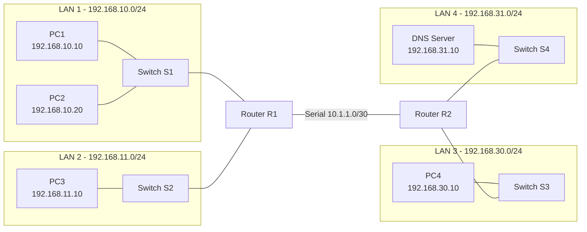

# COM398 Systems Security

# Week 9 – Access Control Lists (ACLs)

## Complete Cisco Packet Tracer Practical Guide

---

# Introduction

In today's seminar, we will learn how Access Control Lists (ACLs) are used to control communication between different networks.

You will build a complete network using Cisco Packet Tracer, configure all devices, establish communication between different networks, investigate an existing ACL, remove it, and finally configure your own Standard IPv4 ACL.

The practical consists of two activities:

**Activity 1: Investigate an Existing ACL**
- Verify network connectivity.
- Identify where an ACL has been configured.
- Determine whether it is applied inbound or outbound.
- Remove the existing ACL.
- Verify network connectivity again.

**Activity 2: Configure a Standard IPv4 ACL**
- Create an ACL.
- Apply the ACL to the correct router interface.
- Verify the ACL configuration.
- Test permitted and denied communication.

---

# Learning Objectives

By the end of today's seminar, you should be able to:

- Understand the purpose of an Access Control List.
- Build a network topology using Cisco Packet Tracer.
- Configure PCs, switches, routers, and servers.
- Configure IPv4 addresses and default gateways.
- Configure router interfaces.
- Configure static routing between networks.
- Verify network connectivity using ping.
- Identify an existing ACL.
- Remove an ACL from a router.
- Configure and apply a Standard IPv4 ACL.
- Understand inbound and outbound ACL directions.
- Verify ACL behaviour using network tests.

---

# Part 1 – Understanding the Network Topology

## Step 1: Examine the Network

The network consists of four separate LANs connected using two routers.


> **Note:** The diagram is a Packet Tracer-style illustration, not a screenshot of an actual Packet Tracer project. If using GitHub, upload the image into the same folder as this README, or update the image path.

## Network Topology



## Step 2: Identify the Required Devices

Open Cisco Packet Tracer.

You will need the following devices:

| Device | Model | Quantity |
|---|---|---|
| Router | Cisco 1941 | 2 |
| Switch | Cisco 2960-24TT | 4 |
| PC | PC-PT | 4 |
| Server | Server-PT | 1 |

Rename the devices as follows:

**Routers**
- R1
- R2

**Switches**
- S1
- S2
- S3
- S4

**End Devices**
- PC1
- PC2
- PC3
- PC4
- DNS Server

---

# Part 2 – Build the Network in Packet Tracer

## Step 3: Add the Routers

1. Open Cisco Packet Tracer.
2. Select **Network Devices**.
3. Select **Routers**.
4. Choose **1941**.
5. Drag two routers into the workspace.
6. Rename them R1 and R2.

## Step 4: Add the Switches

1. Select **Network Devices**.
2. Select **Switches**.
3. Choose **2960-24TT**.
4. Drag four switches into the workspace.
5. Rename them S1, S2, S3, and S4.

## Step 5: Add the PCs

1. Select **End Devices**.
2. Choose **PC-PT**.
3. Add four PCs.
4. Rename them PC1, PC2, PC3, and PC4.

## Step 6: Add the DNS Server

1. Select **End Devices**.
2. Choose **Server-PT**.
3. Add one server.
4. Rename it DNS Server.

## Step 7: Install Serial Modules

The Cisco 1941 router may not initially have a serial interface.

For R1:

1. Click R1.
2. Open the **Physical** tab.
3. Turn the router off.
4. Locate the **HWIC-2T** module.
5. Drag the module into a compatible empty slot.
6. Turn the router back on.

Repeat the same steps for R2.

The router should now have a serial interface.

For this guide, we use:

`Serial0/0/0`

If Packet Tracer assigns a different serial interface number, use the actual interface number shown on your router.

## Step 8: Connect the Devices

Select the **Connections** lightning-bolt icon.

For PC-to-switch and switch-to-router connections, choose **Copper Straight-Through**.

| Source Device | Source Port | Destination Device | Destination Port |
|---|---|---|---|
| PC1 | FastEthernet0 | S1 | Fa0/1 |
| PC2 | FastEthernet0 | S1 | Fa0/2 |
| S1 | Gi0/1 | R1 | Gi0/0 |
| PC3 | FastEthernet0 | S2 | Fa0/1 |
| S2 | Gi0/1 | R1 | Gi0/1 |
| PC4 | FastEthernet0 | S3 | Fa0/1 |
| S3 | Gi0/1 | R2 | Gi0/0 |
| DNS Server | FastEthernet0 | S4 | Fa0/1 |
| S4 | Gi0/1 | R2 | Gi0/1 |

### Connect the Routers

1. Select **Serial DCE**.
2. Click R1 and select `Serial0/0/0`.
3. Click R2 and select `Serial0/0/0`.

The DCE side must provide clocking.

We will configure this later.

> Some links may initially appear red or amber. This is normal until the interfaces are enabled and the network finishes initialising.

---

# Part 3 – IP Addressing

## Step 9: Understand the IP Addressing Scheme

The network contains four LANs.

| Network | Devices |
|---|---|
| 192.168.10.0/24 | PC1 and PC2 |
| 192.168.11.0/24 | PC3 |
| 192.168.30.0/24 | PC4 |
| 192.168.31.0/24 | DNS Server |

The routers are connected through:

`10.1.1.0/30`

## End Device IP Addressing

| Device | IP Address | Subnet Mask | Default Gateway |
|---|---|---|---|
| PC1 | 192.168.10.10 | 255.255.255.0 | 192.168.10.1 |
| PC2 | 192.168.10.20 | 255.255.255.0 | 192.168.10.1 |
| PC3 | 192.168.11.10 | 255.255.255.0 | 192.168.11.1 |
| PC4 | 192.168.30.10 | 255.255.255.0 | 192.168.30.1 |
| DNS Server | 192.168.31.10 | 255.255.255.0 | 192.168.31.1 |

## Router R1 IP Addressing

| Interface | IP Address | Subnet Mask |
|---|---|---|
| G0/0 | 192.168.10.1 | 255.255.255.0 |
| G0/1 | 192.168.11.1 | 255.255.255.0 |
| S0/0/0 | 10.1.1.1 | 255.255.255.252 |

## Router R2 IP Addressing

| Interface | IP Address | Subnet Mask |
|---|---|---|
| G0/0 | 192.168.30.1 | 255.255.255.0 |
| G0/1 | 192.168.31.1 | 255.255.255.0 |
| S0/0/0 | 10.1.1.2 | 255.255.255.252 |

---

# Part 4 – Configure the PCs

## Step 10: Configure PC1

1. Click PC1.
2. Select **Desktop**.
3. Select **IP Configuration**.
4. Choose **Static**.
5. Enter:

```text
IP Address:       192.168.10.10
Subnet Mask:      255.255.255.0
Default Gateway:  192.168.10.1
```

Close the window.

## Step 11: Configure PC2

Click:

**PC2 → Desktop → IP Configuration → Static**

Enter:

```text
IP Address:       192.168.10.20
Subnet Mask:      255.255.255.0
Default Gateway:  192.168.10.1
```

## Step 12: Configure PC3

Click:

**PC3 → Desktop → IP Configuration → Static**

Enter:

```text
IP Address:       192.168.11.10
Subnet Mask:      255.255.255.0
Default Gateway:  192.168.11.1
```

## Step 13: Configure PC4

Click:

**PC4 → Desktop → IP Configuration → Static**

Enter:

```text
IP Address:       192.168.30.10
Subnet Mask:      255.255.255.0
Default Gateway:  192.168.30.1
```

---

# Part 5 – Configure the DNS Server

## Step 14: Configure the Server IP Address

1. Click DNS Server.
2. Select **Desktop**.
3. Select **IP Configuration**.
4. Choose **Static**.

Enter:

```text
IP Address:       192.168.31.10
Subnet Mask:      255.255.255.0
Default Gateway:  192.168.31.1
```

## Step 15: Enable DNS Service (Optional)

1. Open the server.
2. Select **Services**.
3. Select **DNS**.
4. Turn DNS service **On**.
5. Add the following record:

```text
Name:     lab.example
Address:  192.168.31.10
```

6. Click **Add**.

If you want the PCs to resolve this hostname, set their DNS Server field to:

`192.168.31.10`

> DNS name resolution is optional for this ACL practical. The main connectivity tests use IP addresses.

---

# Part 6 – Configure the Switches

Switches allow devices within the same LAN to communicate.

For this exercise, the default VLAN 1 is sufficient. Management IP addresses are not required.

## Step 16: Configure Switch S1

Click:

**S1 → CLI**

If the initial configuration dialog appears, enter `no`.

Type:

```cisco
enable
configure terminal

hostname S1

interface range fastEthernet 0/1 - 2
switchport mode access
no shutdown
exit

interface gigabitEthernet 0/1
switchport mode access
no shutdown
exit

end
copy running-config startup-config
```

Press Enter to accept the destination filename if prompted.

## Step 17: Configure Switch S2

Click:

**S2 → CLI**

```cisco
enable
configure terminal

hostname S2

interface fastEthernet 0/1
switchport mode access
no shutdown
exit

interface gigabitEthernet 0/1
switchport mode access
no shutdown
exit

end
copy running-config startup-config
```

## Step 18: Configure Switch S3

Click:

**S3 → CLI**

```cisco
enable
configure terminal

hostname S3

interface fastEthernet 0/1
switchport mode access
no shutdown
exit

interface gigabitEthernet 0/1
switchport mode access
no shutdown
exit

end
copy running-config startup-config
```

## Step 19: Configure Switch S4

Click:

**S4 → CLI**

```cisco
enable
configure terminal

hostname S4

interface fastEthernet 0/1
switchport mode access
no shutdown
exit

interface gigabitEthernet 0/1
switchport mode access
no shutdown
exit

end
copy running-config startup-config
```

## Step 20: Verify Switch Configuration

On each switch:

```cisco
enable
show interfaces status
show vlan brief
```

Check that:

- Connected ports are enabled.
- Ports are assigned to VLAN 1.
- Devices are connected to the intended ports.

If `show interfaces status` is unsupported, use:

```cisco
show interfaces
show vlan brief
```

---

# Part 7 – Configure Router R1

## Step 21: Open Router R1 CLI

Click:

**R1 → CLI**

If prompted to enter the initial configuration dialog, type `no`.

## Step 22: Configure Router R1

Enter the following commands:

```cisco
enable
configure terminal

hostname R1

interface gigabitEthernet 0/0
description LAN_192.168.10.0
ip address 192.168.10.1 255.255.255.0
no shutdown
exit

interface gigabitEthernet 0/1
description LAN_192.168.11.0
ip address 192.168.11.1 255.255.255.0
no shutdown
exit

interface serial 0/0/0
description LINK_TO_R2
ip address 10.1.1.1 255.255.255.252
no shutdown
exit

ip route 192.168.30.0 255.255.255.0 10.1.1.2
ip route 192.168.31.0 255.255.255.0 10.1.1.2

end
copy running-config startup-config
```

### Explanation

- `enable` enters privileged EXEC mode.
- `configure terminal` enters global configuration mode.
- `hostname R1` names the router.
- `interface` selects a network interface.
- `ip address` assigns an IPv4 address.
- `no shutdown` enables the interface.
- `ip route` creates a static route to another network.
- `copy running-config startup-config` saves the configuration.

---

# Part 8 – Configure Router R2

## Step 23: Open Router R2 CLI

Click:

**R2 → CLI**

## Step 24: Configure Router R2

```cisco
enable
configure terminal

hostname R2

interface gigabitEthernet 0/0
description LAN_192.168.30.0
ip address 192.168.30.1 255.255.255.0
no shutdown
exit

interface gigabitEthernet 0/1
description LAN_192.168.31.0
ip address 192.168.31.1 255.255.255.0
no shutdown
exit

interface serial 0/0/0
description LINK_TO_R1
ip address 10.1.1.2 255.255.255.252
no shutdown
exit

ip route 192.168.10.0 255.255.255.0 10.1.1.1
ip route 192.168.11.0 255.255.255.0 10.1.1.1

end
copy running-config startup-config
```

---

# Part 9 – Configure the Serial Connection

## Step 25: Identify the DCE Side

The router-to-router serial connection requires clocking on the DCE side.

On R1:

```cisco
enable
show controllers serial 0/0/0
```

Check whether R1 is the DCE or DTE end.

If R1 is the DCE end:

```cisco
configure terminal

interface serial 0/0/0
clock rate 64000
no shutdown

end
copy running-config startup-config
```

If R2 is the DCE end, configure the clock rate on R2 instead.

Only the DCE side requires the clock rate command.

## Step 26: Verify Serial Connectivity

On R1:

```cisco
show ip interface brief
```

On R2:

```cisco
show ip interface brief
```

The serial interface should show:

```text
Status:    up
Protocol:  up
```

If the serial link is down, check:

- Whether both routers have serial modules.
- Whether the correct serial cable is used.
- Whether both serial interfaces are enabled.
- Whether the DCE side has a clock rate.
- Whether the serial IP addresses are correct.

---

# Part 10 – Verify Router Interfaces and Routing

## Step 27: Check Router Interfaces

On both routers:

```cisco
enable
show ip interface brief
```

Expected results:

| Interface | Status | Protocol |
|---|---|---|
| GigabitEthernet0/0 | up | up |
| GigabitEthernet0/1 | up | up |
| Serial0/0/0 | up | up |

If an interface is administratively down:

```cisco
configure terminal
interface gigabitEthernet 0/0
no shutdown
end
```

Use the appropriate interface name if another interface is disabled.

## Step 28: Verify Routing Tables

On R1:

```cisco
show ip route
```

On R2:

```cisco
show ip route
```

Both routers should have routes to all four LANs.

The directly connected networks should appear with `C`.

The remote networks configured using static routes should appear with `S`.

---

# Part 11 – Test Network Connectivity

## Step 29: Test the Default Gateways

Open:

**PC1 → Desktop → Command Prompt**

Run:

```text
ping 192.168.10.1
```

On PC2:

```text
ping 192.168.10.1
```

On PC3:

```text
ping 192.168.11.1
```

On PC4:

```text
ping 192.168.30.1
```

On DNS Server:

```text
ping 192.168.31.1
```

All tests should succeed when the network is configured correctly.

The first ping may time out while ARP resolves the destination MAC address. Retry if necessary.

## Step 30: Test Communication Between Networks

From PC1:

```text
ping 192.168.10.20
ping 192.168.11.10
ping 192.168.30.10
ping 192.168.31.10
```

From PC2:

```text
ping 192.168.31.10
```

From PC3:

```text
ping 192.168.30.10
```

From PC4:

```text
ping 192.168.31.10
```

Record your results:

| Source | Destination | Pass / Fail |
|---|---|---|
| PC1 | PC2 | |
| PC1 | PC3 | |
| PC1 | PC4 | |
| PC1 | DNS Server | |
| PC2 | DNS Server | |
| PC3 | PC4 | |
| PC4 | DNS Server | |

Before an ACL is applied, all these connections should succeed.

---

# Activity 1 – Investigate an Existing ACL

## Scenario

A network administrator has already configured an ACL on R1.

Some devices are unable to communicate with other networks.

Your task is to:

1. Identify the ACL.
2. Find where it is applied.
3. Determine its direction.
4. Remove the ACL.
5. Verify network connectivity again.

> **Important:** If your seminar tutor has supplied a Packet Tracer file containing an ACL, use that file. Do not replace the existing ACL configuration.

---

## Instructor Preparation – Sample ACL for a Network Built from Scratch

**This section is for the seminar tutor only.**

If the network has been built from scratch, the tutor can configure the following ACL on R1 before students begin the investigation.

```cisco
enable
configure terminal

access-list 10 deny host 192.168.10.10
access-list 10 permit any

interface gigabitEthernet 0/0
ip access-group 10 in

end
copy running-config startup-config
```

This ACL blocks packets sourced from PC1 when they enter R1 through G0/0.

PC1 can still communicate with PC2 because they are on the same LAN and do not need to send their traffic through R1.

---

## Step 31: Test Connectivity While the ACL Is Active

From PC1:

```text
ping 192.168.10.20
ping 192.168.11.10
ping 192.168.30.10
ping 192.168.31.10
```

From PC2:

```text
ping 192.168.31.10
```

For the sample ACL, the expected results are:

| Test | Expected Result |
|---|---|
| PC1 → PC2 | Pass |
| PC1 → PC3 | Fail |
| PC1 → PC4 | Fail |
| PC1 → DNS Server | Fail |
| PC2 → DNS Server | Pass |

Record your observations.

---

## Step 32: Locate the Existing ACL

Select:

**R1 → CLI**

Enter:

```cisco
enable
show access-lists
```

For the sample configuration, the output should contain rules equivalent to:

```text
Standard IP access list 10
    10 deny host 192.168.10.10
    20 permit any
```

Now enter:

```cisco
show running-config
```

Find the interface configuration containing:

```text
ip access-group 10 in
```

You can also use:

```cisco
show ip interface gigabitEthernet 0/0
```

### Questions

1. What is the ACL number?
2. Which IP address is denied?
3. Which interface is using the ACL?
4. Is the ACL applied inbound or outbound?
5. Why is PC1 unable to communicate with remote networks?

Do not remove the ACL until instructed by your seminar tutor.

---

## Step 33: Remove the Existing ACL

For the sample ACL on R1:

```cisco
enable
configure terminal

interface gigabitEthernet 0/0
no ip access-group 10 in
exit

no access-list 10

end
copy running-config startup-config
```

The command:

```cisco
no ip access-group 10 in
```

removes the ACL from the interface.

The command:

```cisco
no access-list 10
```

deletes the ACL definition.

If your supplied Packet Tracer file uses a different ACL number or interface, substitute the actual values you discovered.

---

## Step 34: Verify ACL Removal

On R1:

```cisco
show access-lists
show running-config
show ip interface gigabitEthernet 0/0
```

Confirm that the ACL is no longer applied.

From PC1:

```text
ping 192.168.11.10
ping 192.168.30.10
ping 192.168.31.10
```

The previously blocked connections should now succeed.

### Activity 1 Questions

1. Why could PC1 communicate with PC2 even when the ACL was active?
2. What does `in` mean in an ACL configuration?
3. What does `out` mean?
4. Why is it important to test before and after removing an ACL?
5. What is the purpose of `permit any`?

---

# Activity 2 – Configure a Standard IPv4 ACL

## Scenario

The university wants to prevent PC1 from accessing the DNS Server network.

PC1:

`192.168.10.10`

DNS Server network:

`192.168.31.0/24`

However:

- PC1 should still communicate with PC3.
- PC1 should still communicate with PC4.
- Other PCs should still reach the DNS Server.

A Standard IPv4 ACL checks the **source IP address**.

It does not check destination IP addresses or port numbers.

For this scenario, we will apply the ACL outbound on **R2 G0/1**, close to the destination network.

---

## Step 35: Verify Connectivity Before Applying the ACL

From PC1:

```text
ping 192.168.11.10
ping 192.168.30.10
ping 192.168.31.10
```

All three should succeed before applying the new ACL.

---

## Step 36: Create Standard ACL 20

Open:

**R2 → CLI**

Enter:

```cisco
enable
configure terminal

access-list 20 deny host 192.168.10.10
access-list 20 permit any

end
```

### Explanation

| Command | Purpose |
|---|---|
| `access-list 20` | Creates numbered Standard ACL 20 |
| `deny host 192.168.10.10` | Denies packets sourced from PC1 |
| `permit any` | Permits packets from other source addresses |

Without `permit any`, the implicit deny at the end of the ACL would block other traffic through that interface as well.

---

## Step 37: Apply ACL 20 to Router R2

On R2:

```cisco
configure terminal

interface gigabitEthernet 0/1
ip access-group 20 out

end
copy running-config startup-config
```

### Why Apply It Outbound?

Packets travelling to the DNS Server network leave R2 through G0/1.

Applying ACL 20 outbound on this interface blocks PC1 from that destination network while allowing PC1 to reach other networks.

---

## Step 38: Verify the ACL Configuration

On R2:

```cisco
show access-lists
show running-config
show ip interface gigabitEthernet 0/1
```

Verify that:

- ACL 20 exists.
- PC1 is denied.
- Other source addresses are permitted.
- ACL 20 is applied outbound on R2 G0/1.

---

## Step 39: Test the Final Network

Run the following tests:

| Source | Command | Expected Result |
|---|---|---|
| PC1 | `ping 192.168.31.10` | Fail |
| PC1 | `ping 192.168.30.10` | Pass |
| PC1 | `ping 192.168.11.10` | Pass |
| PC2 | `ping 192.168.31.10` | Pass |
| PC3 | `ping 192.168.31.10` | Pass |
| PC4 | `ping 192.168.31.10` | Pass |

### Important Technical Point

A Standard IPv4 ACL filters traffic using the source IPv4 address.

It does not specifically block DNS port 53.

To filter traffic based on destination addresses, protocols, or port numbers, an Extended ACL would be required.

---

## Step 40: Inspect ACL Matches

After testing, run on R2:

```cisco
show access-lists 20
```

Depending on the Packet Tracer IOS implementation, the output may include packet match counters.

---

# Part 12 – Troubleshooting

| Problem | Possible Cause | Solution |
|---|---|---|
| Router link is red | Interface disabled | Check `no shutdown` |
| Serial link is down | Clocking or cabling issue | Check DCE clock rate and serial interfaces |
| PC cannot ping gateway | Incorrect IP settings | Verify IP address, mask, and gateway |
| PC can ping gateway but not remote LAN | Missing route | Check `show ip route` |
| PC1 cannot reach remote networks in Activity 1 | Existing ACL | Investigate ACL on R1 |
| PC1 still reaches DNS after Activity 2 | ACL not applied correctly | Check ACL 20 on R2 G0/1 outbound |
| All PCs lose access to DNS | Missing permit rule | Verify `permit any` |
| Invalid CLI command | Incorrect mode or interface | Check the prompt and interface name |

## Useful Verification Commands

```cisco
show ip interface brief
show ip route
show running-config
show access-lists
show vlan brief
```

## Understanding CLI Modes

```text
Router>            User EXEC Mode

Router#            Privileged EXEC Mode

Router(config)#    Global Configuration Mode

Router(config-if)# Interface Configuration Mode
```

Use:

```cisco
end
```

to return to privileged EXEC mode.

---

# Part 13 – Save Your Work

## Step 41: Save Device Configurations

On each router and switch:

```cisco
enable
copy running-config startup-config
```

## Step 42: Save the Packet Tracer File

In Packet Tracer:

**File → Save As**

Suggested filename:

```text
COM398_Week9_ACL_StudentID.pkt
```

---

# Student Evidence Checklist

Before finishing the seminar, ensure you have completed the following:

- [ ] Built the complete Packet Tracer topology.
- [ ] Added two Cisco 1941 routers.
- [ ] Added four Cisco 2960 switches.
- [ ] Added four PCs and one DNS Server.
- [ ] Connected all devices using the correct cables.
- [ ] Configured IP addresses and default gateways.
- [ ] Configured all four switches.
- [ ] Configured both routers.
- [ ] Enabled all required interfaces.
- [ ] Configured serial clocking on the DCE side.
- [ ] Configured static routing.
- [ ] Verified router interfaces.
- [ ] Tested network connectivity.
- [ ] Identified the existing ACL in Activity 1.
- [ ] Identified the ACL interface and direction.
- [ ] Removed the existing ACL.
- [ ] Verified connectivity after removing the ACL.
- [ ] Created Standard IPv4 ACL 20.
- [ ] Applied ACL 20 outbound on R2 G0/1.
- [ ] Verified the final network behaviour.
- [ ] Saved the completed Packet Tracer project.

---

# Final Reflection Questions

Answer the following questions in your own words.

1. What is the purpose of an Access Control List?

2. What is the difference between a Standard ACL and an Extended ACL?

3. Why did we apply ACL 20 outbound on R2 G0/1?

4. What does the following command mean?

   `access-list 20 deny host 192.168.10.10`

5. Why is `permit any` necessary in this scenario?

6. Why can PC1 still communicate with PC4 after ACL 20 is applied?

7. How can you verify that an ACL has been applied to the correct router interface?

8. What would happen if ACL 20 were applied inbound on R1 G0/0 instead?

9. What is the difference between removing an ACL from an interface and deleting the ACL itself?

10. Why is it important to verify connectivity before configuring an ACL?

---

# End of Week 9 Seminar

By completing this practical, you have:

- Built and configured a network using Cisco Packet Tracer.
- Configured PCs, switches, routers, and a DNS Server.
- Established communication between multiple IPv4 networks.
- Investigated an existing Access Control List.
- Removed an ACL and verified connectivity.
- Created and applied a Standard IPv4 ACL.
- Tested permitted and denied network traffic.

**COM398 Systems Security | Week 9 | Access Control Lists**
